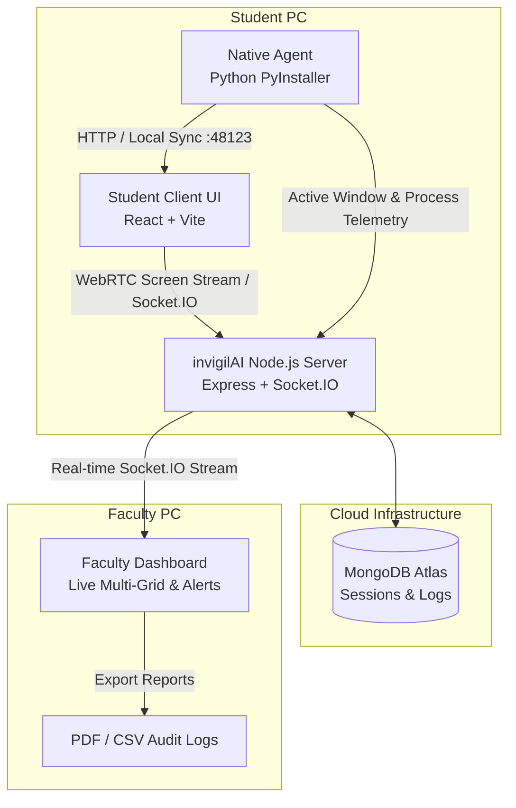

# 🛡️ invigilAI — Automated Lab Invigilation & Proctoring Platform

[](https://opensource.org/licenses/MIT)
[](https://nodejs.org/)
[](https://react.dev/)
[](https://python.org/)
[](https://socket.io/)
[](https://www.mongodb.com/)

> **invigilAI** is a real-time intelligent exam proctoring and laboratory invigilation ecosystem. It combines low-latency desktop telemetry, browser activity tracking, automated AI tool detection, full-screen share enforcement, and live faculty audit dashboards with instant violation alerts and exportable compliance reports.

---

## 📌 Table of Contents

- [Key Capabilities](#-key-capabilities)
- [System Architecture](#-system-architecture)
- [Project Structure](#-project-structure)
- [Technology Stack](#-technology-stack)
- [Local Development Setup](#-local-development-setup)
- [Cloud Deployment Guide](#-cloud-deployment-guide)
  - [Backend on Render](#1-backend-on-render)
  - [Frontend on Vercel](#2-frontend-on-vercel)
- [Authors & Project Team](#-authors--project-team)
- [License](#-license)

---

## ✨ Key Capabilities

- 🖥️ **Enforced Entire-Screen Proctoring**: Guarantees full-display screen streaming with automated rejection of single tabs or application windows.
- 🤖 **AI Assistant & Website Detection**: Deep heuristics identify unauthorized tab usage and window switches (ChatGPT, Claude, Gemini, Copilot, DeepSeek, YouTube, StackOverflow, etc.).
- ⏱️ **Real-Time Faculty Command Center**: Multi-student grid streaming via WebSockets / Socket.IO with sub-second violation notifications and live event feeds.
- 🔍 **Granular Student Activity Auditing**: Track window title switches (VS Code, File Explorer, Terminals, Notepad, Browsers) with exact timestamps.
- 📊 **Academic Compliance Reports**: Export full-session incident audits in both **PDF** and **CSV** formats, including per-student filterable violation logs.
- 🛑 **Automatic Process Lifecycle**: The lightweight background agent automatically syncs with exam session states and terminates itself cleanly when the exam ends or disconnects.

---

## 🚀 System Architecture



---

## 📂 Project Structure

```
invigil-ai/
├── agent/                     # Native Windows Desktop Monitoring Agent
│   └── invigil_agent.py       # Telemetry monitor, window tracker, and local API
├── client/                    # Faculty & Student Web Applications (React + Vite)
│   ├── public/                # Static assets & icons
│   ├── src/
│   │   ├── components/        # Dashboard, student grid, feeds, modal components
│   │   ├── App.tsx            # Main application router
│   │   └── main.tsx           # Entry point
│   ├── package.json
│   └── vite.config.ts
├── server/                    # Core Real-Time API Server (Node.js + Express)
│   ├── models/                # MongoDB Mongoose schemas (Session, Log, Student)
│   ├── server.js              # Express app & Socket.IO event controllers
│   └── package.json
├── render.yaml                # Render cloud deployment blueprint
└── README.md                  # Comprehensive project documentation
```

---

## 🛠️ Technology Stack

| Domain | Technology | Purpose |
| :--- | :--- | :--- |
| **Frontend** | React 18, Vite 5, Tailwind CSS | High-performance faculty dashboard and student exam portal |
| **Icons & UI** | Lucide React, html2canvas, jsPDF | Modern UI iconography and on-the-fly PDF report generation |
| **Backend** | Node.js, Express, Socket.IO 4 | Real-time bi-directional messaging, session coordination, and telemetry ingestion |
| **Database** | MongoDB Atlas, Mongoose | Persistent audit trails, student records, and exam session data |
| **Desktop Agent** | Python 3.10+, PyInstaller, Win32 API | Native Windows window-switch detection, browser heuristics, and process monitoring |
| **Deployment** | Vercel (Client), Render (Server) | High-availability cloud hosting with automated CI/CD pipelines |

---

## 💻 Local Development Setup

### 1. Prerequisites
- **Node.js**: v18.0.0 or higher
- **Python**: v3.10 or higher
- **MongoDB**: Local MongoDB instance running on `mongodb://127.0.0.1:27017` or a MongoDB Atlas URI

### 2. Backend Server Setup
```bash
cd server
npm install
npm run dev
```
> The server will start on `http://localhost:5000` with hot-reloading.

### 3. Frontend Client Setup
```bash
cd client
npm install
npm run dev
```
> The client dashboard will launch at `http://localhost:5173`.

### 4. Running the Desktop Proctoring Agent
```bash
cd agent
python invigil_agent.py
```
> The agent binds locally to `127.0.0.1:48123` and automatically attaches to active exam sessions.

---

## 🌐 Cloud Deployment Guide

### 1. Backend on Render

1. Navigate to [dashboard.render.com](https://dashboard.render.com) and click **New +** $\rightarrow$ **Web Service**.
2. Connect your GitHub repository (`invigil-ai`).
3. Set the following configurations:
   - **Name**: `invigilai-backend`
   - **Root Directory**: `server`
   - **Runtime**: `Node`
   - **Build Command**: `npm install`
   - **Start Command**: `npm start`
4. Add the necessary **Environment Variables**:
   - `NODE_ENV`: `production`
   - `PORT`: `5000`
   - `MONGO_URI`: `your-mongodb-atlas-connection-string`
5. Click **Create Web Service**. Note your deployment URL (e.g., `https://invigilai-backend.onrender.com`).

---

### 2. Frontend on Vercel

1. Navigate to [vercel.com](https://vercel.com) and select **Add New...** $\rightarrow$ **Project**.
2. Import the `invigil-ai` repository.
3. Configure project settings:
   - **Framework Preset**: `Vite`
   - **Root Directory**: `client`
   - **Build Command**: `npm run build`
   - **Output Directory**: `dist`
4. Add **Environment Variables**:
   - `VITE_BACKEND_URL`: `https://invigilai-backend.onrender.com` *(Render backend URL)*
5. Click **Deploy**.

---

## 👥 Authors & Project Team

This project is developed as an academic capstone initiative under the **Department of Information Technology**, **Vidyavardhini's College of Engineering & Technology (VCET)**, University of Mumbai.

- **Varun Kuwar** ([@VarunKuwar](https://github.com/VarunKuwar))
- **Pasikanti Saikrishna** ([@saikrishnass](https://github.com/saikrishnass))
- **Krishna Pandya**

---

## 📄 License

This project is licensed under the [MIT License](LICENSE).
